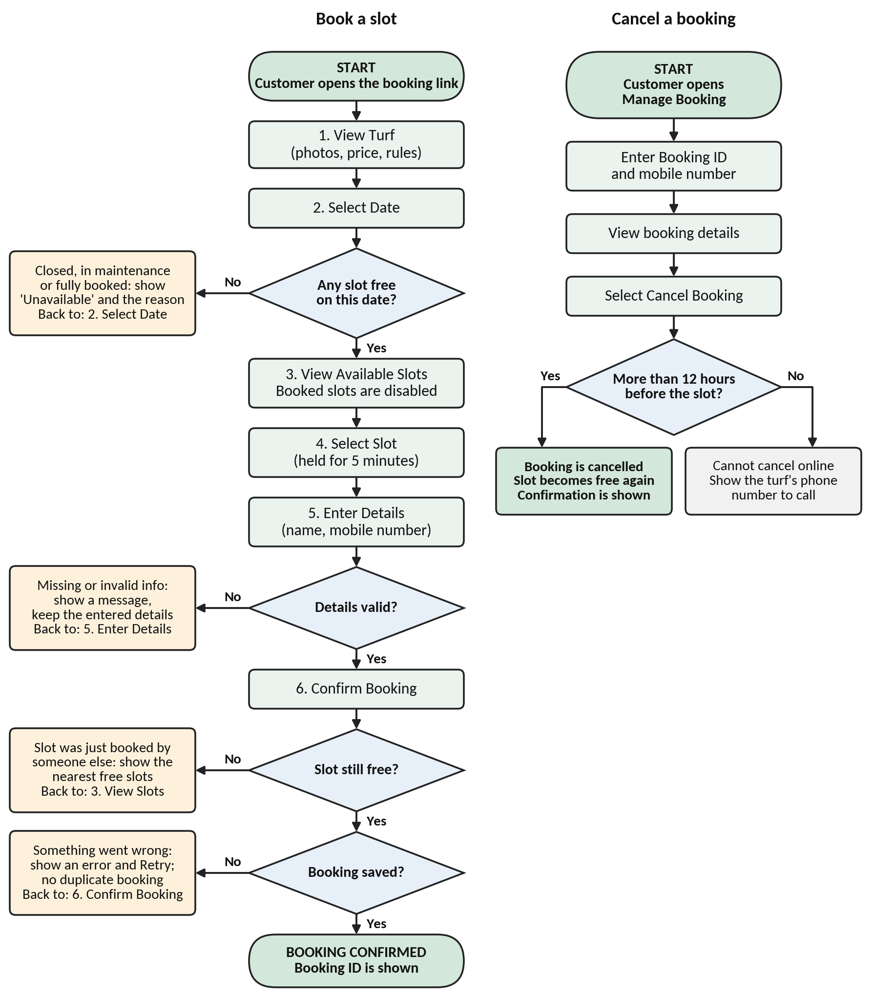
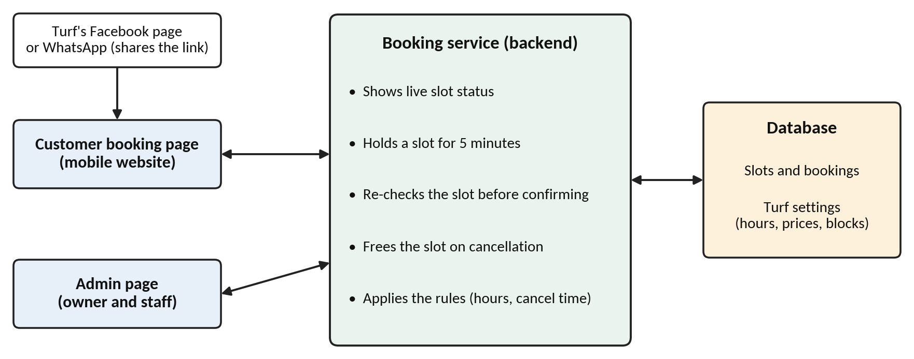
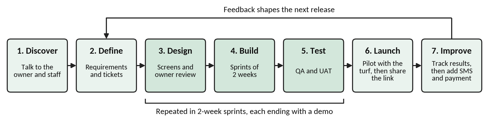

# Turf Ground Booking System: Product Management Case Study

A local sports turf takes bookings by phone, Facebook and WhatsApp. Customers can't see which slots are free, and the team writes every booking down by hand, so messages get missed and the same slot can be promised twice.

This case study covers the requirement analysis, user flow, Jira tickets and QA/UAT test cases for a simple booking system that removes that manual work. **The core idea:** slot availability updates automatically, and staff only step in for exceptions such as maintenance blocks or phone bookings.

## Files

| File | Description |
|---|---|
| [Turf_Booking_Requirement_Analysis_and_User_Flow.pdf](Turf_Booking_Requirement_Analysis_and_User_Flow.pdf) | Problem, users, data needed, availability rules, questions for the owner, assumptions, priorities, trade-offs, delivery plan, success metrics and user flows (7 pages) |
| [Turf_Booking_Jira_Tickets.csv](Turf_Booking_Jira_Tickets.csv) | 8 Jira tickets with descriptions, acceptance criteria and priority |
| [Turf_Booking_QA_UAT_Test_Cases.csv](Turf_Booking_QA_UAT_Test_Cases.csv) | 18 QA/UAT test cases, each linked to a ticket |
| [Turf_Booking_Jira_Tickets_and_UAT_Test_Cases.xlsx](Turf_Booking_Jira_Tickets_and_UAT_Test_Cases.xlsx) | Both sheets in one Excel workbook |
| [Turf_Booking_Product_Presentation.pdf](Turf_Booking_Product_Presentation.pdf) | 12-slide walkthrough of the problem and the solution |

## Key decisions

- **MVP first:** view slots, book, cancel, and a simple admin page. Online payment and SMS reminders come in a later release.
- **Automatic availability:** a slot is available, held (for 5 minutes), booked or blocked. The system checks the slot again at confirmation, so two people can never book the same slot.
- **No accounts:** customers book with their name and mobile number, and manage the booking with the booking ID and mobile number.
- **Prioritised** as Must have, Should have and Later.
- **Before development:** 10 questions for the owner, plus 10 working assumptions to use until they are answered.

## Customer user flow

## System overview

## Delivery plan

Scrum-style Agile in two-week sprints, each ending with a demo for the owner.

## Jira tickets

| ID | Type | Title | Priority |
|---|---|---|---|
| TURF-1 | Story | View Turf Details | Medium |
| TURF-2 | Story | View Available Slots | High |
| TURF-3 | Story | Book a Slot | High |
| TURF-4 | Task | Prevent Double Booking | High |
| TURF-5 | Task | Booking Confirmation | Medium |
| TURF-6 | Story | Cancel a Booking | High |
| TURF-7 | Story | Admin: Manage Bookings | Medium |
| TURF-8 | Story | Admin: Block Slots | Medium |

## How success is measured

- Share of bookings made through the system
- Zero double bookings
- Under one minute from opening the page to a confirmed booking
- Fewer booking calls and messages for staff each week
- Slot use (especially off-peak) and no-shows

## Context

Completed in September 2026 as a take-home assignment for a Product Management Intern role.

## Contact

Md. Rahat Pervez | rahatparvez.official@gmail.com | [LinkedIn](https://www.linkedin.com/in/md-rahat-pervez) | [Portfolio](https://rahatparvez.framer.website/)
